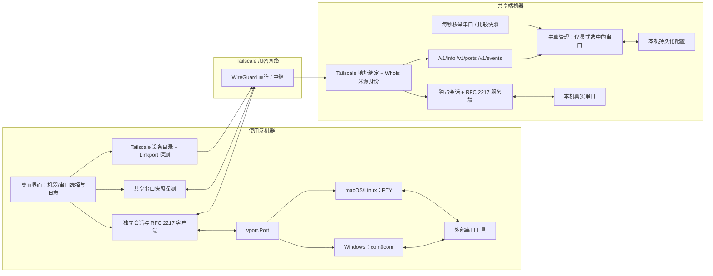

# Linkport 0.0.1 架构

## 目标与当前状态

原生桌面使用真实 Tailscale 状态/设备与操作系统串口枚举；`engine` 协调端口共享、Tailscale-only 监听、来源 WhoIs 鉴权、远端服务发现和真实 RFC 2217 会话。每条连接通过统一 `vport` 生成独立 PTY/com0com 映射，日志来自实际 RX/TX。物理设备、实际两机和 Windows 驱动仍需目标环境联调。自动重连尚未实现，断开后保留日志，恢复后手动连接。单独的设计预览继续使用示例数据。



## 两套本机清单

本机管理视图能看到所有可用串口，并能更改共享选择。远程 `/v1/ports` 和 `/v1/events` 只能看到已共享项，未共享端口的名称、USB 属性和数量都不应泄漏。HTTP 服务不提供远程开启共享的写接口。

共享规则按身份持久化。USB 有可用的序列号时使用 VID/PID/序列号；同一身份对应多个接口时必须避免误匹配，不允许随意认领另一设备。无可靠身份时使用路径，并明确其重插识别能力较弱。

## 插拔与刷新

每秒枚举一次串口，不声称硬实时。检测失败与「成功且列表为空」区分处理，临时系统错误不得清空共享记录。新增串口默认不共享。拔掉的共享项保留离线记录；设备重新出现后恢复共享资格。

SSE 发送完整的共享清单快照，订阅建立与状态变更均有快照。共享端数据会话订阅该快照，取消共享、拔掉设备或身份变得不明确时立即终止对应通道。慢订阅使用有界缓冲，不能阻塞串口检测。桌面原生状态每秒读取本机引擎，远端目录在每轮查询完成五秒后重新探测；不是硬实时推送。清单恢复不等于数据会话自动重连。

## 网络入口

默认 CLI `serve` 仍是 loopback 开发接口。原生桌面和 CLI `serve --tailscale` 仅绑定当前本机 Tailscale IPv4/IPv6 的 TCP 7700。来源必须是 Tailscale 地址，且官方 CLI WhoIs 返回的节点地址必须匹配 TCP 来源，浏览器 Origin 被拒绝；Tailscale 网络访问策略仍须允许该端口。未共享清单与开启共享写接口只存在于带每次启动随机 token 的桌面本机 API 中。

设备目录读取 `tailscale status --json`，只采用其实际 peer ID、IP、在线状态和主机名。探测器最多八路并发，限制请求时间、响应尺寸和清单项数；不经过系统 HTTP 代理，不跟随重定向，且要求对端 `/v1/info` 的节点 ID 与设备目录一致。新连接只能选择目录里已探测出的共享端口，不能提交任意主机或 URL。瞬时状态查询失败保留已建立会话、将目录标为待确认并拒绝新连接；确认网络关闭、退出或账号切换后关闭相关会话。

`POST /v1/connect?id=...&baud=...` 要求 HTTP Upgrade，检查明确共享、在线、身份唯一和占用状态后打开物理串口，再升级为 RFC 2217 字节流。Telnet IAC 转义保证二进制不变；设置请求使用实际设置值确认，未支持的硬件流控和持续 BREAK 不伪装成功。

## 桌面和日志

本机直接监听与远端映射共用会话存储和日志操作。本机打开只接受当前枚举清单中的身份与路径，不要求 Tailscale 或共享选择；共享端桥接与本机监听通过同一个物理端口 broker 互斥打开。网络切换只关闭远端会话，本机设备移除则单独关闭对应本机会话。

会话键由目标机器 ID 和端口身份 ID 共同构成，不使用一个全局「当前连接」。会话管理器持有多条独立的 RFC 2217 客户端和 `vport.Port`，每条会话有各自的取消上下文、映射路径、状态机与有界日志。单条连接的取消或热插拔不影响其他会话。Windows 应为每条映射分配不同的已配置 com0com 端口对，未取得可用端口对时仅阻止新增的该条映射。

桌面连接区显示全部映射；监听区只改变当前观察的会话，不会关闭其他连接。暂停/清空/发送/导出均根据会话 ID 路由，不借全局日志缓冲或串口句柄串接其他会话。Unix 路径由节点/端口身份哈希和安全主机名生成，断开后删除链接。Windows 由用户指定已有端口对，底层排他打开，不能复用同一端口。

界面轮询实际会话状态；日志来自数据桥的 RX/TX 旁路，不会第二次打开物理串口。外部工具与桌面发送共用写锁，参数变更先于该批发送数据完成确认。每条日志记录保留原始字节、实际时间戳和递增序号，缓冲上限为 500 条/128 KiB；暂停只冻结显示。原生保存框导出全部留存记录，包含 HEX 与转义文本，不受 UI 筛选影响。虚拟串口接收队列有上限，消费者持续不读取时会报告缓冲区满并关闭会话，避免无限占用内存。

## 代码组织

```text
linkport/
├── cmd/linkport/            CLI 与诊断入口
├── desktop/                Wails v3 独立模块、设置、登录、签名更新与图标
├── internal/
│   ├── api/                共享快照、SSE、鉴权接入点
│   ├── config/             显式共享规则的持久化
│   ├── engine/             本机运行时、真实设备/端口发现、Tailscale 监听及鉴权
│   ├── tailnet/            官方 CLI 的真实设备目录与 WhoIs 适配
│   ├── bridge/             共享串口独占、HTTP Upgrade、共享撤销
│   ├── rfc2217/            二进制转义、协商及串口参数确认
│   ├── session/            独立映射、真实 RX/TX、有界日志与写入仲裁
│   ├── serialport/         本机串口枚举和设备身份
│   ├── share/              轮询、共享状态、订阅
│   ├── version/            0.0.1 和构建元数据
│   └── vport/              已有跨平台虚拟串口实现
│       ├── vport.go
│       ├── pty_unix.go
│       └── com0com_windows.go
├── docs/
│   ├── design/             共享视觉外壳、独立真实数据脚本和设计预览
│   ├── architecture.md
│   └── releasing.md
├── scripts/                CLI / 桌面原生打包
├── tools/update-sign/      桌面更新签名工具
├── .github/workflows/      测试及 Release 自动化
└── VERSION
```

尚未完成的行为：自动重连、物理线路错误通知、硬件流控与持续 BREAK。不随程序分发或安装 com0com 驱动。真实网络入口复用当前系统 Tailscale，不引入另一个嵌入式节点，也不需要在应用中保存 Tailscale API key。
