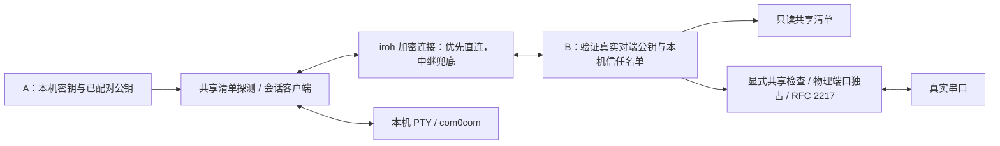

# Linkport 0.0.1 架构

本文侧重串口、会话与运行时模块。端与云服务的完整职责和数据归属见
[端与云服务架构](system-architecture.md)，操作流程见 [交互时序](interaction-sequences.md)。
后续对外展示以 [官网内容与展示方案](website-brief.md) 为参考。

## 目标与当前状态

原生桌面使用 iroh 设备身份与配对信任名单，`engine` 协调端口共享、真实服务探测和 RFC 2217 会话。`p2p` 使用固定版本的社区 Go 实现 `github.com/tmc/go-iroh v0.3.0`，不是 n0 官方 Go SDK。每条连接通过统一 `vport` 生成独立 PTY/com0com 映射，日志来自实际 RX/TX。串口数据会话不自动重连；独立设计预览仍使用示例数据。



设备身份、配对、网络服务和中继配置详见 [iroh.md](iroh.md)。公共地址发现只发布中继地址；端口、日志和配对名单保存在客户端。局域网 mDNS 可重新定位已知设备，发现结果不代表已获得授权。

## 两套本机清单

本机管理视图能看到所有可用串口，并能更改共享选择。远程 `/v1/ports` 和 `/v1/events` 只能看到已共享项，未共享端口的名称、USB 属性和数量都不应泄漏。HTTP 服务不提供远程开启共享的写接口。

共享规则按身份持久化。USB 有可用的序列号时使用 VID/PID/序列号；同一身份对应多个接口时必须避免误匹配，不允许随意认领另一设备。无可靠身份时使用路径，并明确其重插识别能力较弱。

## 插拔与刷新

每秒枚举一次串口，不声称硬实时。检测失败与「成功且列表为空」区分处理，临时系统错误不得清空共享记录。新增串口默认不共享。拔掉的共享项保留离线记录；设备重新出现后恢复共享资格。

SSE 发送完整的共享清单快照，订阅建立与状态变更均有快照。共享端数据会话订阅该快照，取消共享、拔掉设备或身份变得不明确时立即终止对应通道。慢订阅使用有界缓冲，不能阻塞串口检测。桌面原生状态每秒读取本机引擎，远端目录在每轮查询完成五秒后重新探测；不是硬实时推送。清单恢复不等于数据会话自动重连。

## 网络入口

原生桌面和 CLI `serve` 使用 iroh QUIC 双向流承载 HTTP 控制和 RFC 2217 通道，不再绑定 Tailscale 地址或调用外部 CLI。服务端从 QUIC 连接提取已验证公钥，忽略调用方自报身份；每次请求重新检查本机授权，浏览器 Origin 被拒绝。`serve --local-api` 保留 loopback 只读调试接口。完整本机清单、开启共享、邀请生成和设备管理通过本机界面或 CLI 操作，不提供对端管理 API；桌面本机 API 要求每次启动随机 token。

未知设备通常在握手后被拒绝。存在有效邀请时，只允许它尝试配对接口；必须提交高熵单次令牌，且提交公钥必须匹配握手身份，才能持久化双方信任。邀请生成替换旧邀请，五分钟到期，重启失效。每个流先完成新鲜随机挑战，再解析 HTTP，避免 QUIC 会话恢复中的旧请求重放触发串口操作。

设备目录仅来自已配对公钥。探测器最多八路并发，限制请求时间、响应尺寸和清单项数，不经过系统 HTTP 代理、不跟随重定向，并核对 `/v1/info` 的身份。缓存地址失败后按稳定公钥重新查询地址发现。暂时探测失败不会主动拆除仍可用的数据会话；真实流关闭后记录断开原因。移除设备会关闭其所有连接；网络配置或身份变更暂停网络，本机监听继续工作。

`POST /v1/connect?id=...&baud=...` 要求 HTTP Upgrade，检查明确共享、在线、身份唯一和占用状态后打开物理串口，再升级为 RFC 2217 字节流。Telnet IAC 转义保证二进制不变；设置请求使用实际设置值确认，未支持的硬件流控和持续 BREAK 不伪装成功。

## 桌面和日志

本机直接监听与远端映射共用会话存储和日志操作。本机打开只接受当前枚举清单中的身份与路径，不要求网络或共享选择；共享端桥接与本机监听通过同一个物理端口 broker 互斥打开。网络切换只关闭远端会话，本机设备移除则单独关闭对应本机会话。

会话键由目标机器 ID 和端口身份 ID 共同构成，不使用一个全局「当前连接」。会话管理器持有多条独立的 RFC 2217 客户端和 `vport.Port`，每条会话有各自的取消上下文、映射路径、状态机与有界日志。单条连接的取消或热插拔不影响其他会话。Windows 应为每条映射分配不同的已配置 com0com 端口对，未取得可用端口对时仅阻止新增的该条映射。

桌面连接区显示全部映射；监听区只改变当前观察的会话，不会关闭其他连接。暂停/清空/发送/导出均根据会话 ID 路由，不借全局日志缓冲或串口句柄串接其他会话。Unix 路径由节点/端口身份哈希和安全主机名生成，断开后删除链接。Windows 由用户指定已有端口对，底层排他打开，不能复用同一端口。

界面轮询实际会话状态；日志来自数据桥的 RX/TX 旁路，不会第二次打开物理串口。外部工具与桌面发送共用写锁，参数变更先于该批发送数据完成确认。每条日志记录保留原始字节、实际时间戳和递增序号，缓冲上限为 500 条/128 KiB；暂停只冻结显示。原生保存框导出全部留存记录，包含 HEX 与转义文本，不受 UI 筛选影响。虚拟串口接收队列有上限，消费者持续不读取时会报告缓冲区满并关闭会话，避免无限占用内存。

## 代码组织

```text
linkport/
├── cmd/linkport/            CLI 与诊断入口
├── desktop/                Wails v3 独立模块、设置、配对、签名更新与图标
├── internal/
│   ├── api/                共享快照、SSE、鉴权接入点
│   ├── config/             显式共享规则的持久化
│   ├── engine/             本机运行时、已配对设备探测、串口和会话协调
│   ├── p2p/                本机密钥、单次配对、信任名单及 iroh 流传输
│   ├── bridge/             共享串口独占、HTTP Upgrade、共享撤销
│   ├── rfc2217/            二进制转义、协商及串口参数确认
│   ├── session/            独立映射、真实 RX/TX、有界日志与写入仲裁
│   ├── serialport/         本机串口枚举和设备身份
│   ├── share/              轮询、共享状态、订阅
│   ├── version/            0.0.1 和构建元数据
│   └── vport/              已有跨平台虚拟串口实现
│       ├── vport.go
│       ├── pty_unix.go
│       └── com0com_windows.go
├── docs/
│   ├── design/             共享视觉外壳、独立真实数据脚本和设计预览
│   ├── architecture.md
│   └── releasing.md
├── scripts/                CLI / 桌面原生打包
├── tools/update-sign/      桌面更新签名工具
├── .github/workflows/      测试及 Release 自动化
└── VERSION
```

尚未完成的行为：自动重连、物理线路错误通知、硬件流控与持续 BREAK。不随程序分发或安装 com0com 驱动。网络端点嵌入应用进程；每台机器持有独立私钥，服务器不保存串口业务状态。
