# Linkport：交互时序

实现快照：**2026-11-16，0.0.1 开发预览**。以下按当前工作区代码整理，
不把未来官网、自建云服务或尚未实现的自动重连画成现有功能。

整体职责见 [端与云服务架构](system-architecture.md)。除特别说明外，
**A 为邀请方或物理串口提供方，B 为导入邀请或使用串口的一方**；两端可以交换角色。

## 1. 首次启动与身份恢复

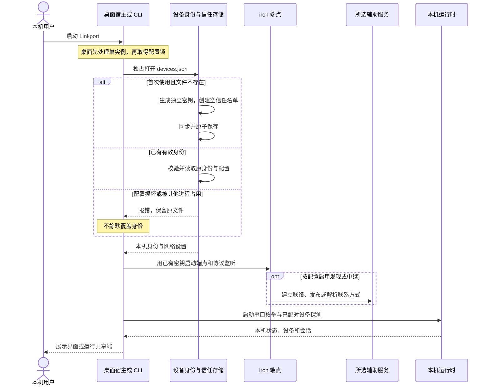

网络服务不是身份签发者。辅助服务不可达与本机身份不存在是两种不同状态；
`Network.state = Running` 也不证明对端服务或串口可用。
`Disabled` 是开发接口/隔离测试等不启动网络端点时的状态，
与“端点已运行、仅禁用中继”的 `disabled` 中继模式不同。

源码：[store.go](../internal/p2p/store.go)、[network.go](../internal/p2p/network.go)、
[main.go](../desktop/main.go)、[engine.go](../internal/engine/engine.go)。

## 2. 生成邀请与双向配对

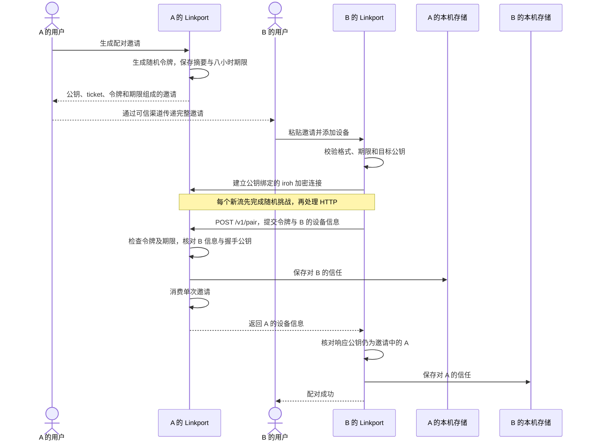

配对过程通过端到端加密连接执行，邀请本身还需要用户通过可信渠道传递。生成邀请是 A 的
明确授权动作，导入邀请是 B 的明确确认动作；当前没有额外的远程审批弹窗或云端批准流程。

失败与恢复：

- 邀请过期、被替换、已使用、令牌被篡改，或提交公钥不匹配握手身份时拒绝。
- 邀请保存在内存，重启后失效。普通 endpoint ticket 不等于配对授权。
- 移除设备同时撤销当前邀请及该设备尚未完成的配对；即使随后重新发起配对，
  旧请求也不能借用新请求的状态恢复信任。重新添加需要新邀请和明确操作。
- 当前双方保存并不是跨机器的原子事务：A 保存成功后，如果响应丢失或 B 保存失败，
  可能只有 A 记住 B。重新生成邀请并配对可恢复；必要时先在 A 移除未完成的设备。
- 配对成功只建立设备信任，默认仍不共享任何新串口。

本机入口：`POST /native/v1/devices/invite`、`POST /native/v1/devices`。
对端入口：`POST /v1/pair`。源码：`CreateInvitation`、`AddDevice`、`acceptPair`。

## 3. 定位设备、复用连接与直连/中继选择

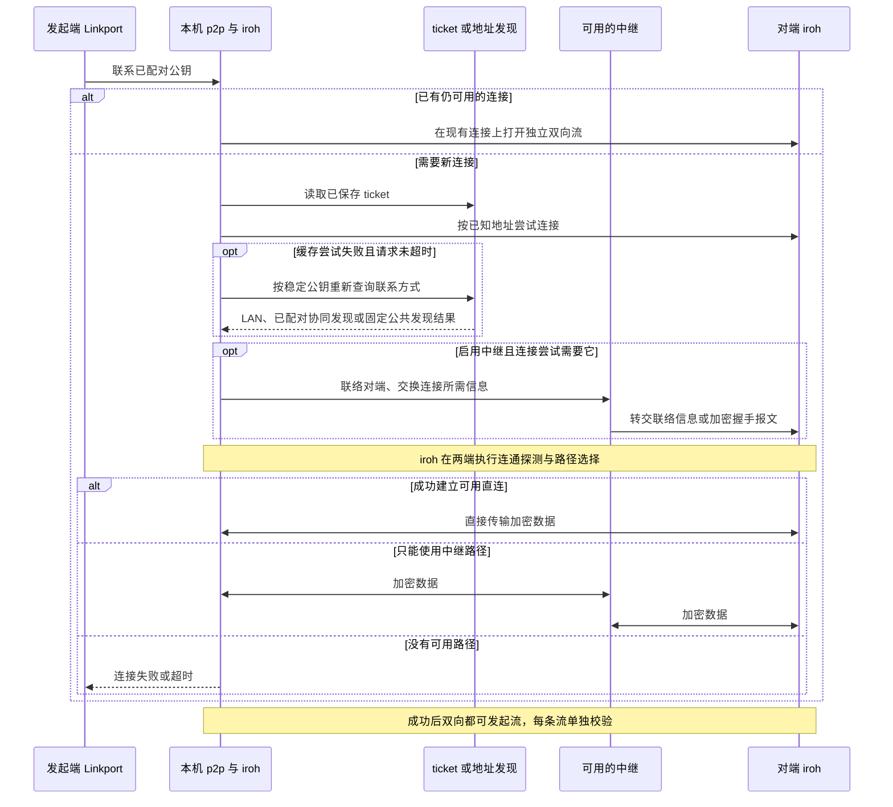

这是连接职责图，不是固定的逐包握手实现。不能把它理解成“每次都必须先绕中继”，也不能
把“先发起业务连接的一端”理解成唯一发送打洞探测包的一端。

当前 `p2p.dial` 的缓存地址尝试有三秒上限，失败后才进行按 ID 的重新解析；调用方还有
总超时。辅助服务按网络模式启用，`disabled` 模式不会访问公共中继或公共地址发现。

中继运行状态不等于设备业务在线状态。已经存在的连接还需在每次业务请求时检查当前信任名单。

## 4. 显式共享与远端清单刷新

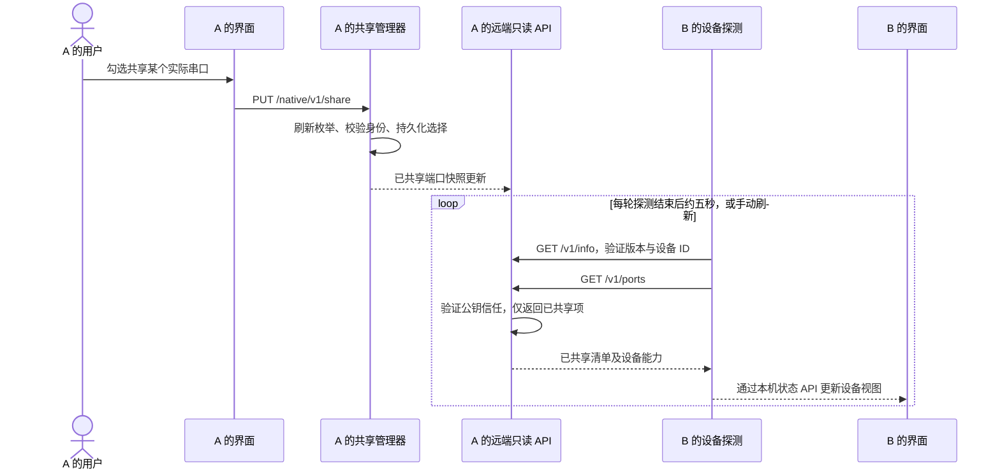

本机枚举约每秒一次，桌面界面约每秒读取本机运行时状态。远端设备/清单探测不是固定五秒
内完成的实时推送：每一轮会花费自身查询时间，结束后再等待约五秒。

远端 API 提供 `/v1/events` SSE，但当前桌面设备目录主要使用周期性 GET 探测；
串口桥接撤销订阅的是共享端进程内的共享快照。不能把两者混成“桌面已通过云推送实时同步”。

探测失败把设备标记为不可达，不会只因一次探测失败就拆掉仍正常传输的串口会话。

## 5. 建立远端串口会话

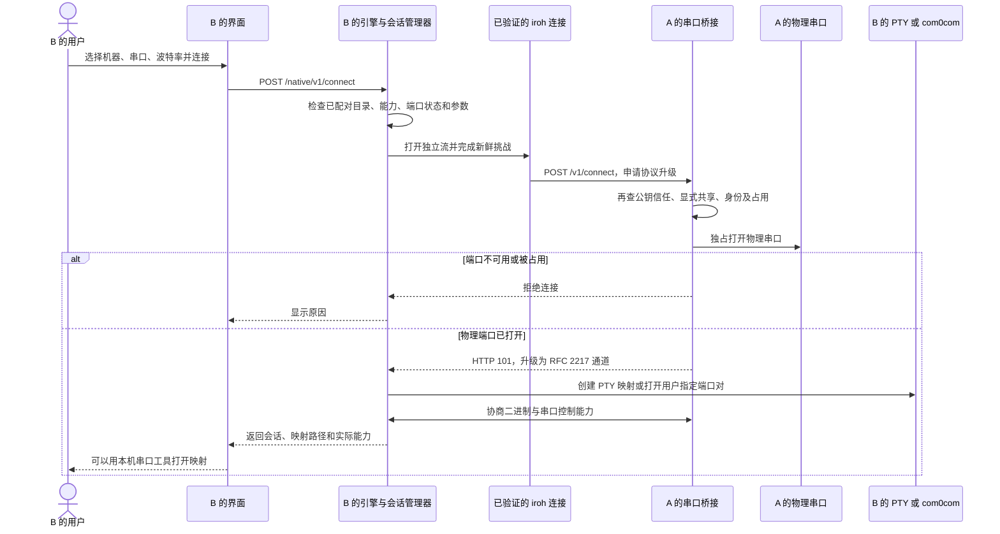

物理端口在远端协议升级前打开，本机虚拟端口在升级成功后建立。后续步骤失败时关闭该流，
释放已经取得的资源；不能把“点击连接”或“HTTP 101”单独当成整个串口会话已经可用。

本机直接监听和远端访问共享同一个物理端口 broker，因此不会同时控制同一物理串口。
Windows 每个并行映射需要独立、已存在的 com0com 端口对。会话身份由对端公钥和端口身份共同确定。

## 6. 串口收发、观察与导出

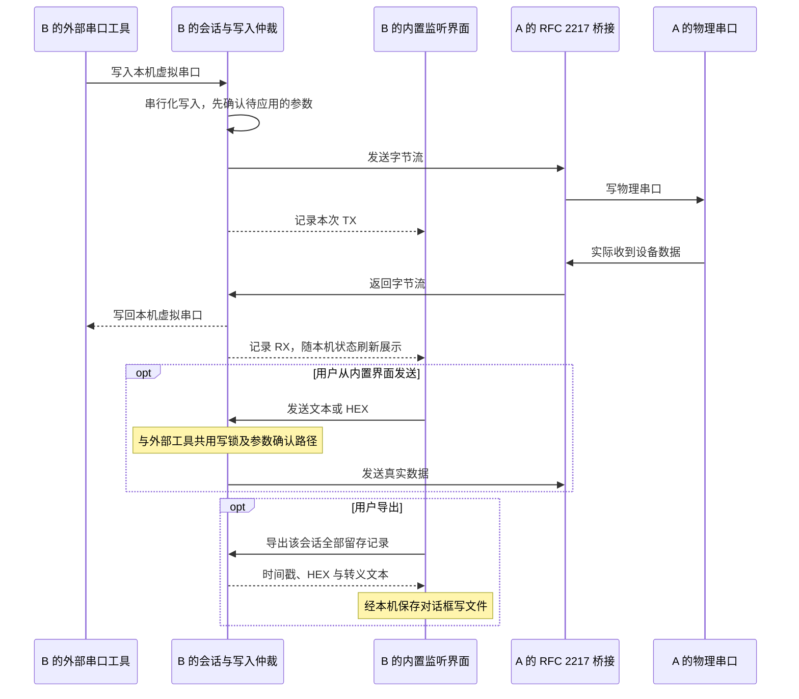

日志是发起映射会话一端的 RX/TX 旁路记录，不会为了观察而第二次打开物理串口。
共享端当前不额外提供一个“所有入站会话的持久化审计日志”或云端日志中心。

暂停只冻结显示；底层传输、采集和有界日志仍继续。每会话留存最多 500 条 / 128 KiB，
导出只包含当时仍留存的记录，且不受界面筛选影响，不代表保留整个会话的无限历史。
虚拟串口消费者持续不读取而导致队列满时，会报告错误并关闭会话。

## 7. 本机直接监听

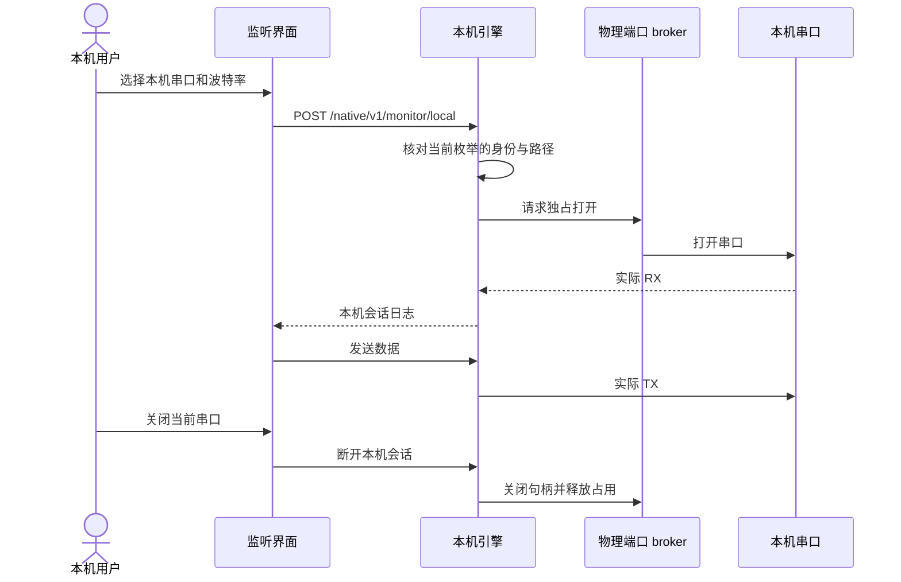

此路径不需要设备配对、共享选择或虚拟串口映射。网络暂停不会主动关闭本机监听；
物理设备移除则会关闭对应本机会话并保留记录。

## 8. 取消共享或拔掉设备

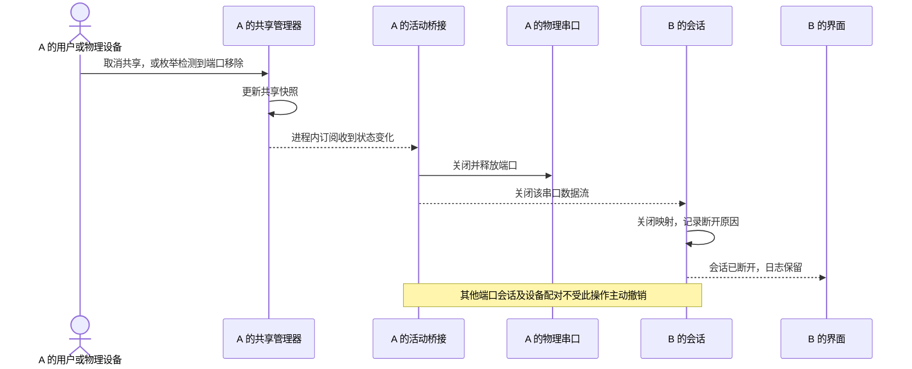

这属于端口资格变化，与移除整台已配对设备不同。设备恢复、重新共享或再次可达后，
当前版本仍需用户重新建立串口会话。

## 9. 移除已配对设备

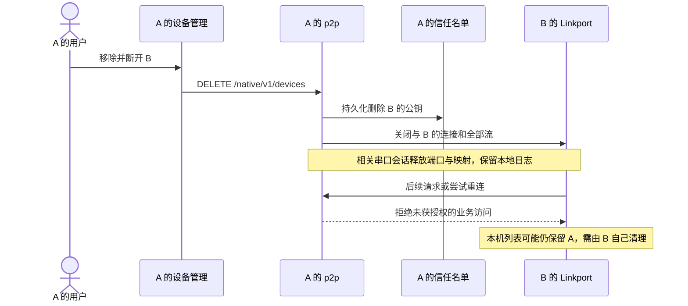

撤销是本机授权变化，不依赖云端在线或中心账号同步。若想以后重新信任，需要新的有效邀请。

## 10. 网络变更与身份重置

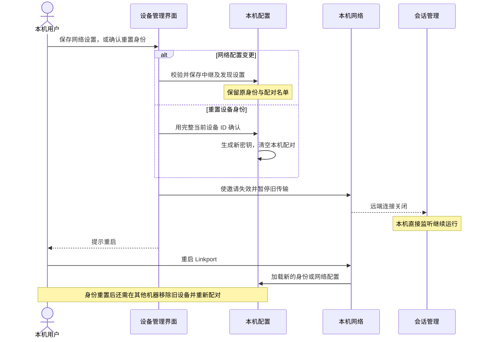

配置保存失败时不当成变更成功。身份重置不会通知所有对端删除旧公钥，也不能撤销被盗
旧私钥在其他机器上的已有授权。

## 11. 签名更新与官网的关系

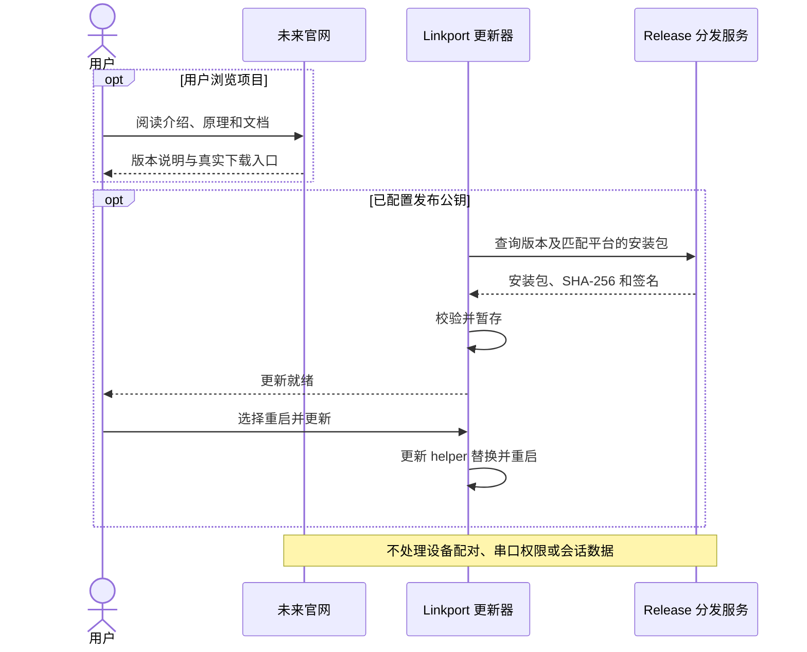

官网尚未上线。开发构建已内嵌发布公钥；维护者已授权并完成 GitHub Actions 发布签名密钥配置。下载包的签名密钥和 iroh
设备身份密钥属于两套独立信任关系，不能混用或把设备密钥交给官网。

## 12. API 边界索引

### 本机桌面管理：均要求 `X-Linkport-Token`

| 接口 | 用途 |
| --- | --- |
| `GET /native/v1/state`、`POST /native/v1/refresh` | 获取本机状态、请求刷新 |
| `GET /native/v1/network`、`PUT /native/v1/network` | 网络状态、配置变更与暂停 |
| `GET /native/v1/devices` | 已配对设备 |
| `POST /native/v1/devices/invite` | 生成单次邀请 |
| `POST /native/v1/devices`、`DELETE /native/v1/devices` | 导入邀请、移除设备 |
| `POST /native/v1/identity/reset` | 确认后重置本机身份 |
| `PUT /native/v1/share` | 本机改变共享选择 |
| `POST /native/v1/connect` | 建立远端串口映射 |
| `POST /native/v1/monitor/local` | 直接监听本机串口 |
| `POST /native/v1/send`、`disconnect`、`clear`、`export` | 操作本机会话及日志，后三者使用相同前缀 |
| `GET/PUT /native/v1/preferences` | 本机偏好 |
| `GET /native/v1/update`、`POST /native/v1/update/{check,download,restart}` | 本机更新流程 |

### 对端接口：在经过验证和随机挑战的 iroh 流内

| 接口 | 访问条件 |
| --- | --- |
| `POST /v1/pair` | 有效邀请、实际握手身份与提交信息匹配 |
| `GET /v1/info`、`GET /v1/ports`、`GET /v1/events` | 已配对公钥；清单只包含显式共享项 |
| `POST /v1/connect` | 已配对，端口共享、身份明确、可独占打开，参数合法 |

`serve --local-api` 是单独的 loopback 只读开发接口，不等于上述真实 iroh 共享服务。
它不提供设备管理或真实远端串口数据通道。

## 13. 当前固定中继策略

当前固定使用内置签名目录中的东京中继 `207.148.110.58:443`。启动时仍校验维护者
Ed25519 签名，但不读取旧目录缓存，不查询远程目录，也不接受运行时目录替换。
节点增减通过后续应用版本交付。设置显示“随应用更新”，不提供单独检查或应用中继配置的按钮。
应用版本检查仍在启动三十秒后和每分钟执行，和中继连通性分开。
仅直连模式继续禁止公共中继与公共地址发现。所有保留的 `/native/v1/relay-update`
与 `check/apply` 接口仍要求本次启动 token；检查不发网络请求，应用接口拒绝运行时替换。
