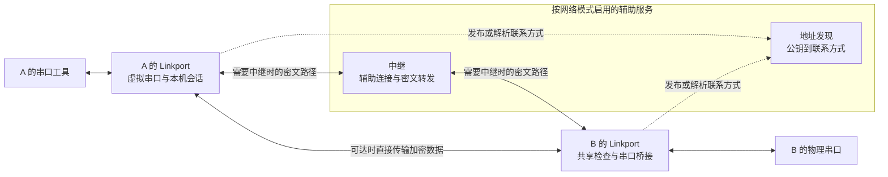
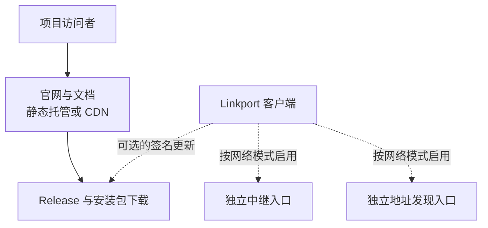

# Linkport：端与云服务架构

实现快照：**2026-11-16，0.0.1 开发预览，`codex/linkport-iroh` 工作区**。

本文说明迁移到 iroh 后的整体职责、连接路径、数据归属与部署边界。具体 API 调用次序见
[交互时序](interaction-sequences.md)，日常操作见 [iroh 使用说明](iroh.md)。

## 1. 产品模型

Linkport 让一台机器上的串口工具，通过本机虚拟串口访问另一台机器显式共享的物理串口。
每台机器运行相同的 Linkport，可以同时提供自己的串口，也可以使用其他已配对机器的串口。

设备在本地生成身份，通过一次性邀请建立信任。串口共享选择、访问判断、物理端口占用、
会话和日志由客户端负责。连接基础设施帮助定位设备、尝试直连并在需要时转发密文。

未来官网负责介绍、文档和下载导航，发布服务负责分发安装包；它们与正在运行的串口会话分离。
当前没有中心账号系统、全局设备目录、云端串口管理后台或云端日志存储。

## 2. 整体拓扑

图中的直连和中继是数据路径选择，不表示每份数据同时走两条路径。连接尝试、打洞和路径
选择由 iroh 管理。中继连接可能保持在线，但直连成功后的串口业务数据可以绕过中继。
地址发现不参与解码或处理串口数据。

两个设备通过局域网直接地址或 mDNS 可达时，可以不使用公共服务；跨互联网能否完全
不用中继，取决于双方地址可达性、NAT 和防火墙条件。

## 3. 客户端内部

客户端包含桌面宿主、核心运行时和串口适配层。CLI 共享端复用相同核心，没有桌面外壳。

| 模块 | 当前职责 | 源码 |
| --- | --- | --- |
| 桌面宿主 | Wails 窗口、菜单栏、设置、设备管理、保存对话框、更新入口 | [desktop](../desktop/) |
| 界面与本机 API | 通过本次启动的随机 token 操作设备、共享与会话；不把管理能力开放给远端 | [native_api.go](../desktop/native_api.go)、[live.js](design/assets/live.js) |
| `engine` | 本机枚举、已配对设备探测、会话创建和资源协调 | [engine.go](../internal/engine/engine.go) |
| `p2p` | 身份与信任存储、单次邀请、QUIC 公钥鉴权、双向流、连接撤销、网络设置 | [network.go](../internal/p2p/network.go)、[store.go](../internal/p2p/store.go) |
| `share` / `config` | 默认不共享、身份匹配、共享配置、插拔快照和本地订阅 | [share](../internal/share/)、[config](../internal/config/) |
| `api` | 只读信息、已共享清单和 SSE；接入串口通道升级 | [http.go](../internal/api/http.go) |
| `bridge` / `serialport` | 检查共享资格、独占打开物理串口、撤销桥接，与本机监听互斥 | [server.go](../internal/bridge/server.go)、[broker.go](../internal/serialport/broker.go) |
| `rfc2217` | 二进制转义、协商、串口参数确认和桥接 | [rfc2217](../internal/rfc2217/) |
| `session` | 独立会话、写入仲裁、真实 RX/TX 记录、有界缓冲、关闭与导出 | [manager.go](../internal/session/manager.go) |
| `vport` | macOS/Linux PTY，Windows 已配置的 com0com 端口对 | [vport](../internal/vport/) |
| CLI | 枚举、共享、配对、身份管理、无桌面共享端与开发接口 | [cmd/linkport](../cmd/linkport/) |

技术基线为 Go 1.26.11、Wails v3.1.0，以及固定版本的社区 Go 实现
`github.com/tmc/go-iroh v0.3.0`。它不是 n0 官方 Go SDK；升级需要重新核对
协议互通、身份校验、流生命周期和各平台构建。

## 4. 四类通信

### 4.1 本机管理

桌面页面调用 `/native/v1/*`，请求带 `X-Linkport-Token`。token 每次启动随机生成，
用于保护本机管理入口，和设备身份私钥不是同一份凭据。

该入口可以读取本机完整清单、改变共享选择、生成邀请、增删设备和重置身份。
它不作为跨机器的公共管理 API。

### 4.2 设备定位与连通

设备 ID 来自公钥。邀请中的 endpoint ticket、局域网 mDNS、固定公共地址发现
提供可尝试的联系方式；发现设备地址不会自动授予业务权限。

当前拨号先复用已有连接。需要新连接时先尝试已保存 ticket；缓存地址尝试最多三秒，
失败且请求仍有效时，再按稳定公钥解析地址。整体请求仍受调用方超时限制。

同一对设备复用经过身份验证的 QUIC 连接。连接可由任一端建立，双方都接收对端发起
的新流；关闭一个 HTTP 流或串口流，不会主动关闭其他流。

### 4.3 对端控制与串口数据

应用协议 ALPN 为 `linkport/1`。每个双向流先完成 `LP1` 前导与新的 32 字节随机挑战，
再解析 HTTP，避免旧流数据重放触发业务操作。

HTTP 请求所用的公钥身份来自 QUIC 握手，不能通过 HTTP 头、自报设备 ID 或来源 IP
替代。普通请求还要经过本机信任名单检查。有效邀请只暂时开放配对机会，不开放串口清单。

只读探测使用 `/v1/info` 和 `/v1/ports`。串口连接通过 `/v1/connect` 完成 HTTP Upgrade，
随后在同一流内运行 RFC 2217 字节与控制帧。

这里的 HTTP 和 RFC 2217 是加密 iroh 流内的协议，不是暴露在公网的明文 HTTP 服务，
也不是一个可以让任意通用 RFC 2217 客户端直接连接的公网 TCP 端口。
现有串口工具通过本机 PTY/com0com 使用远端串口。

### 4.4 软件分发

签名更新从 Release 分发服务获取版本、安装包、校验和及签名。设备身份密钥用于设备通信；
发布签名密钥用于安装包验证，两者独立。

当前未嵌入更新公钥的开发包不会自动安装更新。官网上线也不等于已经提供签名发布渠道。

## 5. 辅助服务的职责

| 组件 | 它负责什么 | 状态与数据边界 |
| --- | --- | --- |
| 局域网 mDNS | 在本地网络重新定位设备 | 发布/解析设备联系方式；不建立信任 |
| 地址发现 | 从设备公钥查找当前联系方式 | 当前公共发布器只发布中继地址；有签名记录和缓存，不等同于实时在线证明 |
| 中继 | 帮助接通两端、参与连通协商、直连不可用时转发数据 | 维护活跃连接和路由等运行状态；可见连接元数据，不能解密串口内容 |
| 官网，规划 | 介绍项目、解释原理、托管文档、导航下载 | 无需持有设备私钥、邀请或串口日志 |
| 发布服务 | 分发安装包、版本信息、校验和及签名 | 属于软件分发，不处理串口会话 |

“中继无业务状态”不代表它不记得当前有哪些连接。它需要运行时路由状态才能转发；
设备所有权、配对和串口共享权限仍由客户端决定。

默认中继由 Linkport 维护者通过签名目录管理；公共地址发现仍由第三方运营。即使内容端到端加密，中继仍可能
观察设备公钥、接入 IP、连接时间，以及它实际承载的流量。可见信息是否记录、保留多久，
取决于服务运营策略；不能把内容加密宣传成完全匿名或完全没有元数据。

## 6. 状态与数据归属

| 数据 | 当前保存位置 | 是否送给辅助服务 |
| --- | --- | --- |
| 本机私钥 seed | 用户配置目录 `linkport/devices.json` | 不发布；不返回桌面页面 |
| 设备名、已配对公钥、ticket、添加时间 | 同一设备配置文件 | 完整信任名单不发布 |
| 配对邀请的 token 摘要与到期时间 | 邀请端进程内存 | 不作为云端配对数据库；完整邀请由用户通过可信渠道传给另一端 |
| 当前联系方式 | endpoint 内存、邀请 ticket、所选发现服务 | 公共发布仅中继地址；邀请和 LAN 发现可包含直接地址 |
| 串口共享规则 | `linkport/shares.json` | 不作为云端目录；仅已共享清单通过加密连接提供给已配对设备 |
| 桌面偏好 | `linkport/desktop.json` | 本机保存 |
| 会话、占用、最近探测结果 | 客户端内存 | 不上报为云端业务状态 |
| RX/TX 日志 | 发起会话或本机监听的客户端内存；用户可导出文件 | 不上传云端；每会话最多 500 条 / 128 KiB |
| 活跃中继连接与路由 | 中继运行时 | 只描述经由该中继的连接，不是全局设备名单 |
| 安装包与更新签名 | Release 分发服务 | 公开分发材料，与本机设备私钥无关 |

Unix 新建配置目录权限为 `0700`，设备配置文件为 `0600`；Windows 使用用户配置目录
的继承访问控制。当前密钥存储是受限文件，不是系统钥匙串，也没有实现加密云备份或账号找回。

## 7. 维护者中继与仅直连

`default` 使用维护者签名目录中的 HTTPS 中继、已配对节点协同发现和固定公共地址发现；
`disabled` 不访问公共中继与地址发现，只使用直接地址和 LAN 发现。
不提供用户自定义中继、发现 URL 或公网监听设置。旧 custom 配置迁移为 default，保留设备身份与配对。

目录更新在线加入新候选并移除旧候选，不重建 endpoint；网络模式变更仍保存、暂停并重启。
运行状态不等同于对端业务在线状态，实际串口访问仍需配对、共享、身份明确与独占占用。

## 8. 访问边界

对远端打开物理串口，当前依次检查：

1. QUIC 连接确认真实设备公钥。
2. 本机信任名单允许该公钥。
3. 串口已由本机用户显式共享，身份明确。
4. 物理端口能独占打开，并满足串口参数限制。
5. 会话期间继续响应取消共享、设备拔出和连接撤销。

当前共享权限是“已配对设备可访问本机显式共享的串口”，没有实现“每个设备分别开放不同串口”
的细粒度 ACL，也没有多人角色、团队管理员或云端审批。

移除设备是本机授权撤销，不会自动删除对端设备列表中的旧条目。重置本机身份不能远程
撤销其他机器对旧公钥的信任，旧密钥泄漏时需要在各个对端移除旧设备。

## 9. 官网与后续自建服务

以下为规划，不表示已经购买节点、配置域名或上线服务。

建议把官网、软件分发、中继和地址发现设为独立服务边界。初期中继和地址发现可以位于同一
台专用机器，但仍分开配置服务入口、日志和资源限制。官网无需与它们共用机器，也不接入业务数据流。

官网故障主要影响介绍、文档或下载入口。发现服务故障可能影响新连接和地址变化后的重连；
中继故障会影响依赖它的数据路径；已建立且仍可用的直连路径不经由这些官网服务。
不能据此承诺服务故障、换网或 NAT 映射变化时所有会话都保持可用。

后续部署需要验证域名与证书、中继协议版本、地址发现读写兼容性、可达性、元数据日志策略、
容量和中继接入限制。基础设施接入限制不能替代客户端配对和串口共享检查。

## 10. 当前验证与能力边界

截至该实现快照，本地已完成：

- 根模块 race 检查和静态检查；实际 loopback iroh 配对、邀请篡改/过期/重用拒绝和连接撤销测试。
- 本机临时中继上的纯中继配对与传输，以及旧流挑战重放拒绝测试。
- iroh 通道上的真实 PTY 二进制收发、端口释放；关键端到端用例连续 20 次通过。
- 桌面 API 与 Chromium 交互测试。
- CLI 三平台六架构编译、Windows 两架构桌面编译、macOS arm64 本机测试包构建。

测试入口见 [network_test.go](../internal/p2p/network_test.go)、
[p2p_unix_test.go](../internal/engine/p2p_unix_test.go)、
[devices_test.go](../desktop/devices_test.go) 和 [check.cjs](../scripts/ui/check.cjs)。
20 次重复结果是本次工作区验证记录，不是固定 CI 并发或性能保证。

真实跨互联网 NAT、正式公共/自建服务质量、Rust iroh 互通、实际 USB 串口以及 Windows
com0com 驱动仍需目标环境验收。CI 配置覆盖原生平台任务，不代表当前工作区已经在所有平台运行过。

当前没有自动串口会话重连、硬件流控、持续 BREAK、云账号、远程开启共享、云端日志或官网控制台。
macOS/Linux PTY 不提供真实 DTR/RTS 透传，Windows 需要用户已有的兼容 com0com 驱动与端口对。
官网表述应遵循 [官网内容与展示方案](website-brief.md)。

## 11. 独立中继服务增量（2026-11-17）

`cmd/linkport-relay` 提供自建中继运行入口，`internal/relayservice` 包装固定版本的
`relayserver`，增加 TLS、健康检查、总连接上限和退出回收，不改变设备配对与串口授权。
具体协议能力、资源限制、部署示例及验证范围见 [自建中继](relay.md)。
东京公网中继已部署，发现服务仍独立；验证范围见 [部署记录](relay-deployment.md)。

## 12. Desktop 协同发现增量（2026-11-17）

中继宿主模块与独立命令同源，普通 desktop 用户的宿主配置入口已移除。设备自身签名的联系方式在已配对通道内
周期交换并持久缓存；旧地址失败时可以向其他已配对设备查询单个目标，再走已有解析兜底。
发现记录不授予信任，设备撤销会清理缓存并阻止在途同步恢复它。

维护者目录包含多个中继时，增加故障候选冷却和备用中继恢复逻辑，不自动使用公共中继，
不重建 endpoint。该增量不包含 VPN、全局设备名单、desktop 多跳串口转发或串口重放。
详细协议、宿主设置、测试与边界见 [中继与协同发现](relay.md)。

2026-11-17 策略更新：desktop 的用户可编辑中继宿主入口已移除，同源模块保留供维护者嵌入。
公共中继、签名目录、证书续期与跨网络验证以 [部署记录](relay-deployment.md) 为准。
